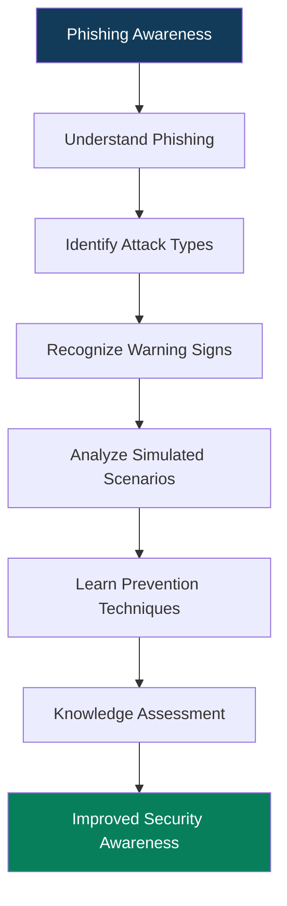

# 🛡️ Phishing Awareness Training
### CodeAlpha Cyber Security Internship | Task 02

<p align="center">
  <strong>Recognizing • Understanding • Preventing Phishing Attacks</strong>
</p>

<p align="center">
  
  
  
  
</p>

---

## 📌 Project Overview

Phishing is one of the most common cybersecurity threats, exploiting human trust and psychological manipulation to steal sensitive information.

This project was developed as part of the **CodeAlpha Cyber Security Internship – Task 02: Phishing Awareness Training**.

The objective was to create an educational presentation that explains how phishing attacks operate, demonstrates common attack techniques, teaches users how to identify suspicious communications, and provides practical strategies to prevent phishing incidents.

The presentation combines cybersecurity concepts, simulated phishing scenarios, visual demonstrations, and knowledge-assessment quizzes to make security awareness easier to understand.

---

## 🎯 What Was the Task?

CodeAlpha assigned the development of a phishing awareness presentation or online training module covering five essential areas:

| Requirement | Description |
|---|---|
| Email & Website Identification | Recognizing phishing emails and fake websites |
| Social Engineering | Understanding psychological manipulation techniques |
| Security Practices | Learning how to prevent phishing attacks |
| Real-World Examples | Demonstrating realistic phishing scenarios |
| Interactive Quizzes | Testing users' ability to identify phishing attempts |

**My approach:** Develop a structured, visually engaging cybersecurity training presentation addressing all five requirements.

---

## ⚙️ What I Developed

The project consists of a 15-slide educational presentation organized into five learning sections.

### 1. Understanding Phishing

- Definition and fundamentals of phishing.
- How phishing attacks operate.
- Phishing attack lifecycle.
- Common types of phishing attacks.

### 2. Identifying Phishing Techniques

- Anatomy of a phishing email.
- Recognizing suspicious sender addresses.
- Identifying fake websites and misleading URLs.
- Social engineering and psychological manipulation.

### 3. Practical Scenarios & Prevention

Three simulated phishing scenarios:

- Banking account suspension scam.
- Fake parcel delivery notification.
- Fraudulent internship offer.

Each scenario explains the warning signs and appropriate actions users should take.

### 4. Interactive Knowledge Assessment

Two scenario-based quizzes:

- **Quiz 1:** Identify a suspicious phishing email.
- **Quiz 2:** Identify a malicious URL and understand misleading subdomains.

Both quizzes include correct answers and explanations to reinforce cybersecurity awareness.

### 5. Security Recommendations

- Password protection and multi-factor authentication.
- Safe browsing practices.
- Email security awareness.
- Incident response steps.
- Reporting suspicious communications.

---

## 🔄 Project Workflow

The following diagram illustrates the learning journey covered by the presentation.



---

## 📊 What Was Achieved?

Through this project, I developed a structured cybersecurity awareness resource that:

- Explains the fundamentals and lifecycle of phishing attacks.
- Demonstrates six common phishing attack techniques.
- Teaches users to identify suspicious emails and deceptive URLs.
- Highlights how attackers exploit human emotions through social engineering.
- Provides three practical simulated phishing scenarios.
- Reinforces learning through two knowledge-assessment quizzes.
- Introduces practical prevention and incident response techniques.

### Key Learning Outcomes

| Area | Knowledge Gained |
|---|---|
| Email Security | Identifying suspicious emails |
| Web Security | Recognizing deceptive URLs |
| Social Engineering | Understanding human-targeted attacks |
| Threat Awareness | Identifying phishing techniques |
| Incident Response | Responding to phishing incidents |

---

## 🧠 Skills Demonstrated

- Cybersecurity Fundamentals
- Phishing Attack Analysis
- Social Engineering Awareness
- Email Security
- URL Inspection
- Security Awareness Training
- Technical Communication
- Educational Presentation Design

---

## 📁 Repository Structure

```text
CodeAlpha_PhishingAwarenessTraining/
│
├── README.md
│
├── Phishing_Awareness_Training.pptx
│
└── assets/
    ├── slide-previews/
    └── screenshots/
```

---

## 🚀 How to Use

1. Clone the repository:

```bash
git clone https://github.com/YOUR-USERNAME/CodeAlpha_PhishingAwarenessTraining.git
```

2. Navigate to the project directory:

```bash
cd CodeAlpha_PhishingAwarenessTraining
```

3. Open `Phishing_Awareness_Training.pptx` using Microsoft PowerPoint or a compatible presentation application.

4. Review the slides and complete the knowledge-assessment quizzes.

---

## ⚠️ Disclaimer

This project is developed strictly for educational and cybersecurity awareness purposes.

All phishing emails, URLs, and attack scenarios included in the presentation are simulated examples. They are intended to help users recognize suspicious activities and improve their cybersecurity awareness.

No real credentials are collected, and no actual phishing attacks are conducted.

---

## 🏢 Internship Information

**Organization:** CodeAlpha  
**Internship Domain:** Cyber Security  
**Project:** Phishing Awareness Training  
**Assigned Task:** Task 02  
**Project Type:** Cybersecurity Awareness & Educational Presentation

---

<p align="center">
  <strong>Think Before You Click. Verify Before You Trust. Stay Secure.</strong>
</p>

<p align="center">
  Developed as part of the CodeAlpha Cyber Security Internship.
</p>
